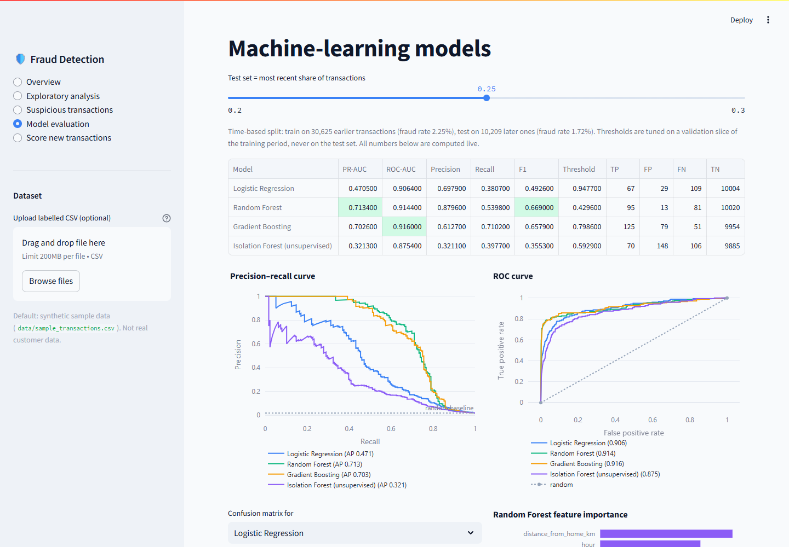
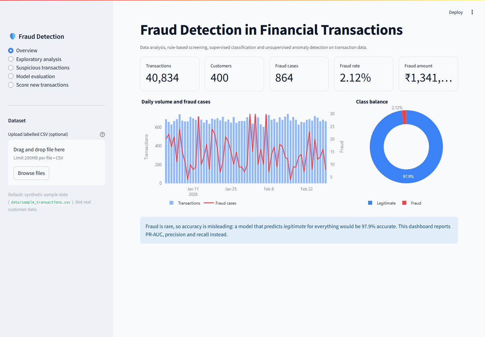
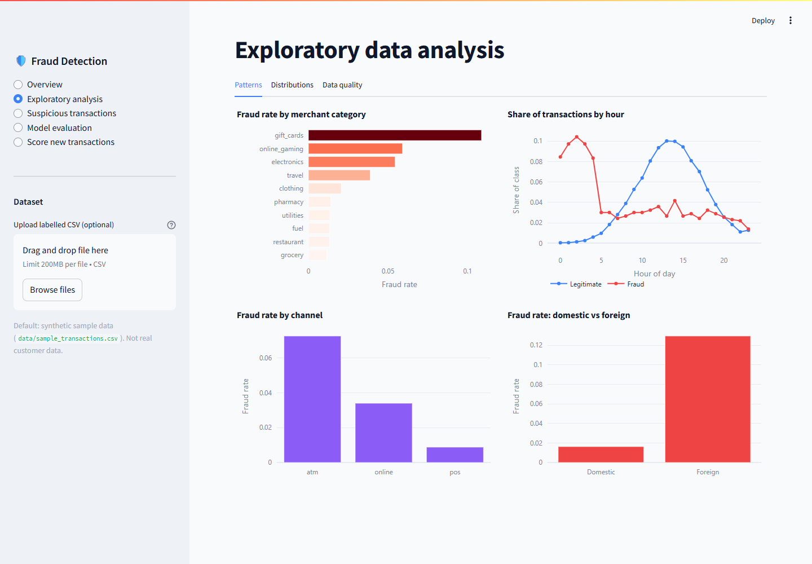
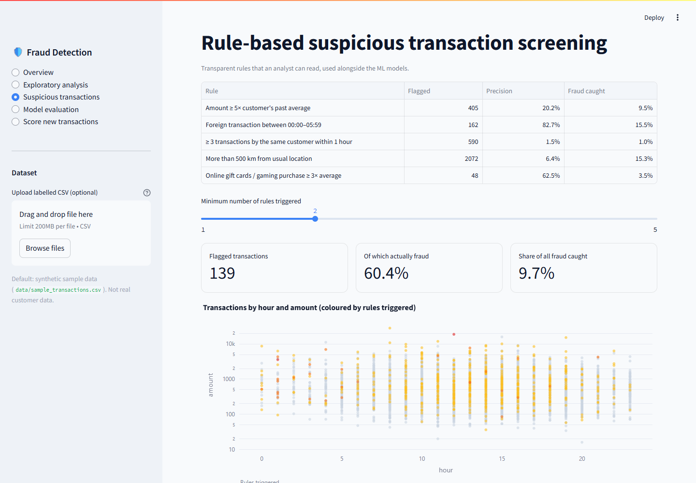
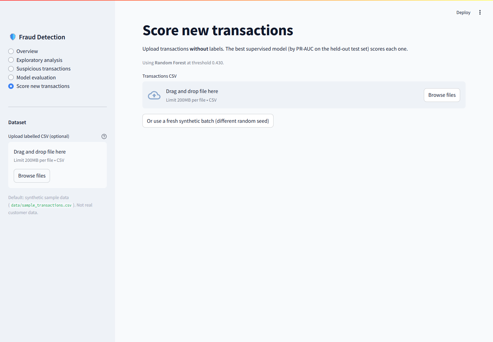

# Fraud Detection in Financial Transactions

End-to-end fraud analytics on transaction data: validation and preprocessing, leakage-free feature engineering, exploratory analysis, rule-based screening of suspicious transactions, supervised classification, unsupervised anomaly detection and imbalance-aware evaluation, all in an interactive Streamlit dashboard.

**Tech stack:** Python 3.11 · pandas · NumPy · scikit-learn · Streamlit · Plotly · joblib · pytest



## Pipeline (3 stages)

| Stage | What happens | Code |
|---|---|---|
| 1. Data preparation and profiling | Schema validation, cleaning, column profile, leakage-free feature engineering | `data_loader.py`, `eda.profile`, `preprocessing.py` |
| 2. Analysis and rule-based screening | EDA of fraud patterns; 5 transparent rules flag suspicious transactions | `eda.py`, `rules.py` |
| 3. Machine-learning detection | Supervised classifiers (LR, RF, GB) plus unsupervised anomaly detection (Isolation Forest), evaluated on a time-based split | `models.py`, `evaluation.py` |

The two analytical techniques are **data analysis** (stages 1–2) and **machine learning** (stage 3).

## Features

- **Data analysis and preprocessing:** schema validation, type coercion, invalid-row handling, missing-value imputation, and a column-level data profile (type, missing values, distinct values, ranges).
- **Feature engineering without look-ahead:** each customer-history feature uses only *earlier* transactions. Features include amount ÷ past average, z-score, 1-hour and 24-hour velocity, minutes since the previous transaction, night/weekend/foreign flags and distance from home.
- **Exploratory data analysis:** fraud rate by category, channel and country; hourly profiles; amount distributions; correlation matrix.
- **Suspicious-transaction screening:** 5 transparent rules with per-rule precision and coverage, plus an adjustable "rules triggered" filter.
- **ML fraud classification:** Logistic Regression, Random Forest and Gradient Boosting, all class-weighted for imbalance.
- **Anomaly detection:** Isolation Forest trained without labels.
- **Model evaluation:** time-based train/test split, PR-AUC (headline metric), ROC-AUC, precision, recall, F1, confusion matrices, PR and ROC curves, feature importance, and an interactive threshold trade-off.
- **Scoring:** upload unlabelled transactions (or generate a fresh synthetic batch) and download the scored CSV.

## Dataset

`data/sample_transactions.csv` is **synthetic** data from `fraud_detection/data_generator.py` (seed 42): 400 customers, 60 days, 40,834 transactions, about 2.1% fraud. Fraud follows known patterns (night-time, foreign, bursts, risky categories, unusually large amounts). The generator also deliberately adds hard cases: small fraud, cloned cards used near home, legitimate travel and large purchases, and about 0.2% flipped labels.

To use your own data, upload a CSV in the sidebar or set `FRAUD_DATA_PATH`. Required columns:
`transaction_id, customer_id, timestamp, amount, merchant_category, channel, country, distance_from_home_km` (plus `is_fraud` = 0/1 for training).

## Results on the synthetic sample (reproducible)

`python scripts/train.py` trains on the earliest 75% of transactions and tests on the most recent 25% (10,209 transactions, 1.72% fraud). These are the numbers from the run on the author's machine:

| Model | PR-AUC | ROC-AUC | Precision | Recall | F1 |
|---|---|---|---|---|---|
| Logistic Regression | 0.471 | 0.906 | 0.698 | 0.381 | 0.493 |
| **Random Forest** | **0.713** | 0.914 | 0.880 | 0.540 | **0.669** |
| Gradient Boosting | 0.703 | 0.916 | 0.613 | 0.710 | 0.658 |
| Isolation Forest (unsupervised) | 0.321 | 0.875 | 0.321 | 0.398 | 0.355 |

> These numbers describe **synthetic** data and say nothing about performance on real bank data. A random classifier would score PR-AUC ≈ 0.017 here. Thresholds are tuned on a validation slice of the training period, never on the test set. The dashboard recomputes everything live.

## Project structure

```
fraud-detection-transactions/
├── app.py                      # Streamlit dashboard (5 pages)
├── fraud_detection/
│   ├── data_generator.py       # synthetic labelled transactions
│   ├── data_loader.py          # CSV loading + schema validation
│   ├── preprocessing.py        # feature engineering, time split, ColumnTransformer
│   ├── eda.py                  # EDA aggregations
│   ├── rules.py                # rule-based suspicious flags
│   ├── models.py               # train/evaluate/save/score
│   └── evaluation.py           # metrics + threshold selection
├── scripts/generate_data.py, scripts/train.py
├── data/sample_transactions.csv
├── docs/ARCHITECTURE.md, docs/screenshots/
├── tests/                      # unit tests + headless dashboard tests
└── requirements.txt, .env.example, .streamlit/config.toml
```

## Installation

```bash
git clone https://github.com/manisha2001-20/fraud-detection-transactions.git
cd fraud-detection-transactions
python -m venv .venv
# Windows: .venv\Scripts\activate      macOS/Linux: source .venv/bin/activate
pip install -r requirements.txt
```

## Running

```bash
streamlit run app.py                 # dashboard at http://localhost:8501
python scripts/train.py              # print the evaluation table, save models/fraud_model.joblib
python scripts/generate_data.py      # regenerate the synthetic dataset
```

To open a specific page directly, add `?page=0` through `?page=4` to the URL.

## Tests

```bash
pytest
```

24 tests cover data validation errors, the no-look-ahead feature checks, chronological splitting, rule logic, data profiling, metrics on hand-computed examples, training, save/load/scoring, EDA helpers, and headless rendering of every dashboard page with Streamlit `AppTest`.

## Screenshots

| Overview | EDA | Suspicious | Scoring |
|---|---|---|---|
|  |  |  |  |

To retake them: run `streamlit run app.py`, open each page and use your browser's screenshot tool.

See [docs/ARCHITECTURE.md](docs/ARCHITECTURE.md) for design details.
